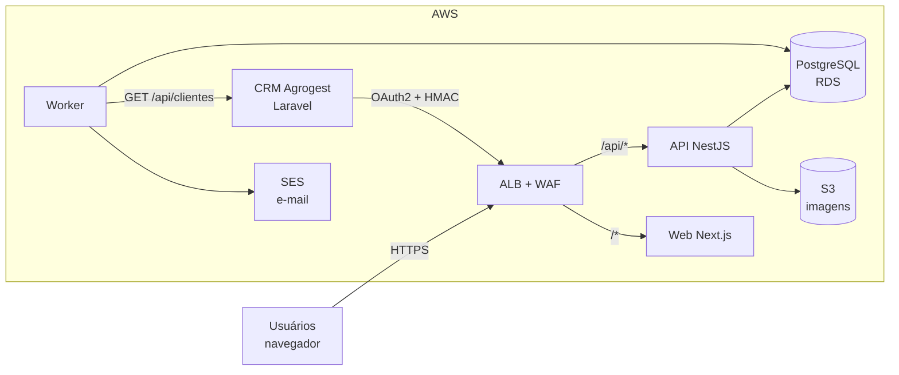

# Arquitetura

## Visão geral

O Estoque Agrogest opera de forma independente, com banco de dados próprio, mas integrado ao CRM
Agrogest. O CRM é a fonte da verdade dos **clientes**; o Estoque é a fonte da verdade dos
**produtos, saldos e movimentações**.



| Componente                                | Responsabilidade                                                                                                        |
| ----------------------------------------- | ----------------------------------------------------------------------------------------------------------------------- |
| **Web** (`apps/web`)                      | Interface responsiva e acessível. Consome somente a API, no mesmo domínio (`/api`).                                     |
| **API** (`apps/api`, `main.ts`)           | REST interna (`/api/v1`), API de integração (`/api/integracao/v1`), autenticação, regras de negócio e motor de estoque. |
| **Worker** (`apps/api`, `main-worker.ts`) | Processa a fila: alertas, e-mails, webhooks e sincronização com o CRM. Também executa as rotinas agendadas.             |
| **PostgreSQL**                            | Dados, livro-razão imutável, fila de tarefas (outbox) e controle de idempotência.                                       |
| **S3**                                    | Imagens de produtos, privadas e servidas por URL pré-assinada.                                                          |

## Decisões de arquitetura

1. **Monorepo TypeScript com schemas compartilhados.** A mesma validação Zod roda no formulário e
   no servidor; o OpenAPI é gerado a partir desses schemas.
2. **Motor de estoque único.** Somente `MotorEstoqueService` altera saldos. Garantias:
   - Toda operação ocorre em uma transação.
   - Os produtos envolvidos são travados em ordem determinística (sem deadlock).
   - As baixas usam `UPDATE` condicional (`quantidade - reservado >= q`), o que mantém o saldo
     correto mesmo sob concorrência, com o `CHECK` do banco como segunda barreira.
   - O livro-razão, o evento no outbox e a auditoria são gravados na mesma transação.
3. **Livro-razão imutável.** Triggers bloqueiam `UPDATE` e `DELETE` em movimentações. Correções são
   feitas por estorno, que referencia a movimentação original. A view `vw_conciliacao_saldos`
   confere o saldo materializado contra o ledger.
4. **Fila no PostgreSQL (outbox transacional).** O evento nasce na mesma transação da operação.
   O worker reserva lotes com `FOR UPDATE SKIP LOCKED` e pode ser escalado horizontalmente. Há
   backoff exponencial e dead-letter (status `FALHOU`, com reprocessamento pela tela). Isso
   dispensa Redis ou SQS e reduz os serviços a operar.
5. **Idempotência em duas camadas.** O cabeçalho `Idempotency-Key` é aplicado por interceptor, e o
   pedido também tem `UNIQUE (origem, id_externo)`. Reenvios do CRM nunca duplicam baixas.
6. **Mesmo domínio para web e API.** O ALB encaminha `/api/*` à API. Os cookies de sessão são
   `SameSite=Strict` e não há CORS entre origens.
7. **Sem dados fictícios.** O seed cria apenas dados de referência (permissões, perfis, unidades e
   o administrador inicial).

## Fluxo de uma saída de estoque

```mermaid
sequenceDiagram
  participant W as Web
  participant A as API
  participant DB as PostgreSQL
  participant K as Worker
  W->>A: POST /api/v1/movimentacoes/saidas (Idempotency-Key)
  A->>DB: reserva a chave de idempotência
  A->>DB: BEGIN; SELECT produtos FOR UPDATE (ordenado)
  A->>DB: UPDATE saldos SET quantidade = quantidade - q WHERE disponível >= q
  alt saldo insuficiente
    A-->>W: 409 SALDO_INSUFICIENTE (RFC 7807)
  else ok
    A->>DB: INSERT movimentação + itens + saída + tarefa (outbox) + auditoria; COMMIT
    A-->>W: 201 Movimentação
    K->>DB: reserva tarefa (SKIP LOCKED)
    K->>DB: avalia mínimo, esgotado e atipicidade → notificações
  end
```

## Módulos da API

`auth`, `usuarios`/`perfis`, `cadastros` (categorias, unidades, locais), `produtos` (com imagens e
kardex), `fornecedores`, `estoque` (motor e movimentações), `compras`, `pedidos`, `inventarios`
(e ajustes), `integracao` (cliente do CRM, sincronização, API OAuth2 e webhooks), `notificacoes`
(alertas e e-mail), `configuracoes`, `dashboard`, `relatorios` (PDF e Excel), `lgpd`, `tarefas`
(fila e agendamentos) e `health`.

## Escalabilidade e evolução

- A API não guarda estado; o cache de permissões dura 30 s e cada instância mantém o seu. Para
  escalar, basta aumentar o número de tarefas ECS (há autoescala por CPU).
- Os workers podem rodar em paralelo, graças ao `SKIP LOCKED`.
- **Novos integradores:** basta criar clientes de API com escopos. Um novo provedor de identidade
  (SSO do CRM) se encaixa na interface `ProvedorAutenticacao`
  (`apps/api/src/modules/auth/provedores.ts`).
- **Catálogo vindo do CRM:** o campo `produtos.id_externo_crm` já existe para o vínculo, caso o CRM
  passe a ter produtos.
