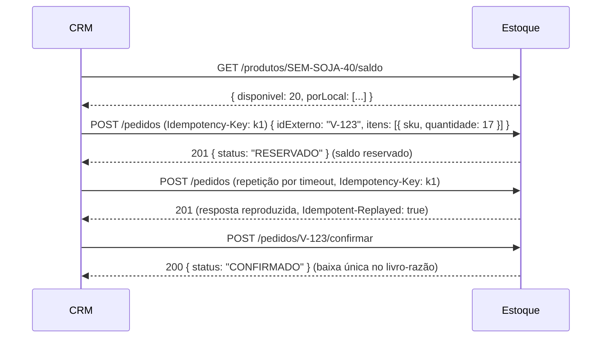

# Integração com o CRM Agrogest

## 1. Análise do CRM existente

O repositório analisado é `github.com/Anarkocyber/crm-agrogest`, PR #1 `release/frontend-v2`, com
backend em Laravel 11 e MySQL. Endpoints **verificados** em `backend/routes/api.php`:

| Endpoint                                                                  | Retorno                                                                                                                   |
| ------------------------------------------------------------------------- | ------------------------------------------------------------------------------------------------------------------------- |
| `GET /api/clientes`                                                       | Lista completa, sem paginação: `id` (UUID), `nome`, `razaosocial`, `cnpj`, `cpf`, `email`, `telefone`, `cidade`, `estado` |
| `GET /api/clientes/{uuid}`                                                | Cliente, ou `404 { message }`                                                                                             |
| `POST`, `PUT`, `DELETE /api/clientes[/{uuid}]`                            | CRUD de clientes (não utilizado pelo Estoque)                                                                             |
| `/api/leads`, `/api/{cliente\|lead}/{uuid}/interacoes`, `/api/interacoes` | Funil de leads e interações (não utilizado)                                                                               |

**Limitações identificadas:**

- O CRM não tem catálogo de produtos nem pedidos ou vendas. Os leads vendem serviços (RENASEM,
  SIPEAGRO, ISO etc.), não itens de estoque.
- A API não tem autenticação (o login do frontend é só visual), webhooks, paginação nem filtro por
  data de alteração.
- **Risco de segurança a corrigir no CRM:** o PR versiona `backend/.env` com `APP_KEY` e
  `DB_PASSWORD` preenchidos.

**Decisão:** o Estoque não altera o CRM. Nenhum endpoint do CRM além dos verificados é utilizado ou
presumido.

## 2. Dados compartilhados e fonte da verdade

| Dado                             | Fonte da verdade                              | Como o Estoque usa                                                    |
| -------------------------------- | --------------------------------------------- | --------------------------------------------------------------------- |
| Clientes                         | **CRM**                                       | Espelho somente leitura (`crm_clientes`), sincronizado periodicamente |
| Produtos, saldos e movimentações | **Estoque**                                   | Expostos ao CRM pela API de integração                                |
| Pedidos de venda                 | **Estoque** (enquanto o CRM não tiver vendas) | Criados na tela do Estoque ou pela API de integração                  |

Mapeamento de clientes (`mapearCliente`, em `crm-sync.service.ts`), com minimização de dados:

| CRM                  | Estoque              | Tratamento                                    |
| -------------------- | -------------------- | --------------------------------------------- |
| `id`                 | `crm_id`             | UUID; chave do vínculo                        |
| `nome`               | `nome`               | —                                             |
| `razaosocial`        | `razao_social`       | —                                             |
| `cnpj`               | `cnpj`               | Somente dígitos; descartado se não tiver 14   |
| `cpf`                | `cpf`                | Somente dígitos; mascarado nas telas e na API |
| `email`              | `email`              | Minúsculas                                    |
| `telefone`, `cidade` | `telefone`, `cidade` | —                                             |
| `estado`             | `uf`                 | Maiúsculas, 2 letras                          |

## 3. Estoque → CRM: sincronização de clientes

- **Gatilhos:** agendada pelo worker, conforme o intervalo configurado (padrão de 15 min, sem
  execuções simultâneas), ou manual em **Integração CRM → Sincronizar agora**.
- Como o CRM não oferece filtro incremental, a leitura é completa (`GET /api/clientes`). Cada
  registro é validado por schema (`crmClienteSchema`); os inválidos são contados e ignorados.
- **Upsert por `crm_id`:** cada registro tem um hash SHA-256 dos campos, e só há atualização quando
  o hash muda. Clientes que deixaram de existir no CRM ficam marcados como `removido_no_crm`, sem
  exclusão, para preservar o histórico.
- **Resiliência:**
  - timeout configurável;
  - 3 tentativas com backoff para erros 5xx, 429 e de rede;
  - circuit breaker de 60 s após 5 falhas seguidas;
  - registro em `integracao_logs` de cada tentativa (método, caminho, HTTP, duração e erro, sem
    dados pessoais);
  - histórico de cada execução em `integracao_execucoes`.
- **Alerta:** depois de N falhas consecutivas (padrão 3) é criada a notificação crítica "Falha de
  sincronização com o CRM", resolvida automaticamente na sincronização seguinte bem-sucedida.
- **Autenticação no CRM:** se o CRM passar a exigir, configure o cabeçalho (ex.: `Authorization`) na
  tela. O valor é armazenado cifrado (AES-256-GCM).
- Um cliente informado em pedido e ainda não espelhado é buscado sob demanda
  (`GET /api/clientes/{id}`).

## 4. CRM → Estoque: API de integração

Base `/api/integracao/v1`. A especificação completa está em `docs/openapi.json` e em `/api/docs`.

### Autenticação (OAuth 2.0 client credentials)

Crie as credenciais em **Integração CRM → Clientes de API**. O `client_secret` é exibido uma única
vez e armazenado como hash Argon2.

```http
POST /api/integracao/v1/oauth/token
Content-Type: application/json

{ "grant_type": "client_credentials", "client_id": "cli_…", "client_secret": "sk_…" }
```

```json
{
  "access_token": "eyJ…",
  "token_type": "Bearer",
  "expires_in": 3600,
  "scope": "estoque:consultar pedidos:gerenciar"
}
```

| Escopo              | Permite                                                                                                                  |
| ------------------- | ------------------------------------------------------------------------------------------------------------------------ |
| `estoque:consultar` | `GET /produtos`, `GET /produtos/{sku}/saldo`, `POST /saldos/consulta`                                                    |
| `pedidos:gerenciar` | `POST /pedidos`, `GET /pedidos/{idExterno}`, `POST /pedidos/{idExterno}/confirmar`, `POST /pedidos/{idExterno}/cancelar` |

### Fluxo de venda (baixa automática sem duplicidade)



- `POST /pedidos` **exige** `Idempotency-Key`. A mesma chave com outro conteúdo retorna `422`.
  Um `idExterno` já existente devolve o pedido original (HTTP 200, `jaExistia: true`), sem nova
  reserva.
- Sem `localCodigo`, a reserva é distribuída automaticamente entre os locais com saldo (local
  padrão primeiro).
- `confirmar` e `cancelar` são idempotentes. Um pedido confirmado não pode ser cancelado: a
  devolução vira entrada.
- **Erros (RFC 7807):**
  - `409 SALDO_INSUFICIENTE`, com `detalhes.disponivel` e `detalhes.solicitado`;
  - `422 REGRA_DE_NEGOCIO` (ex.: SKU inexistente, com `detalhes.skus`);
  - `401` e `403` no formato OAuth (`invalid_token`, `insufficient_scope`).

## 5. Webhooks

### Recebidos do CRM — `POST /api/integracao/v1/webhooks/crm`

Gere o segredo em **Integração CRM → Gerar segredo de entrada**. Ele é exibido uma vez.

| Cabeçalho              | Valor                                                                          |
| ---------------------- | ------------------------------------------------------------------------------ |
| `X-Estoque-Timestamp`  | Unix time em segundos (tolerância de ±5 min, proteção contra replay)           |
| `X-Estoque-Assinatura` | `sha256=` + HMAC-SHA256(segredo, `${timestamp}.${corpo_bruto}`) em hexadecimal |

```json
{ "id": "evt-0001", "tipo": "pedido.criado", "ocorridoEm": "2026-11-06T12:00:00Z", "dados": { … } }
```

| `tipo`               | `dados`                                                                    |
| -------------------- | -------------------------------------------------------------------------- |
| `pedido.criado`      | Mesmo corpo de `POST /pedidos` (`idExterno`, `clienteCrmId?`, `itens[]`)   |
| `pedido.confirmado`  | `{ "idExterno": "…" }`                                                     |
| `pedido.cancelado`   | `{ "idExterno": "…", "motivo": "…" }`                                      |
| `cliente.atualizado` | `{ "clienteId": "<uuid do CRM>" }` (dispara a sincronização desse cliente) |

**Comportamento:**

- A resposta é `202` imediata. O evento vai para a inbox (`integracao_eventos_recebidos`) e é
  processado pelo worker, com novas tentativas.
- Um `id` repetido é ignorado (`duplicado: true`).
- Erros de regra de negócio ficam com status `ERRO` e podem ser reprocessados na tela
  **Integração CRM → Eventos**.
- As operações originadas por webhook aparecem no livro-razão com o responsável
  "CRM Agrogest — Webhooks".

Exemplo de assinatura (Node.js):

```js
const ts = Math.floor(Date.now() / 1000).toString();
const assinatura =
  'sha256=' + crypto.createHmac('sha256', segredo).update(`${ts}.${corpo}`).digest('hex');
```

### Enviados ao CRM — `estoque.saldo_atualizado` (desativado por padrão)

Após cada movimentação, se habilitado e com URL configurada, o Estoque envia
`{ id, tipo, ocorridoEm, dados: { sku, quantidade, reservado, disponivel } }`, assinado com o
segredo de saída, nos mesmos cabeçalhos. Falhas são retentadas com backoff exponencial.

## 6. Validação da integração

- **Testes automatizados** (`apps/api/test/integracao-crm.int.test.ts`): um servidor que reproduz o
  contrato real do CRM cobre criação, atualização, remoção, registros inválidos, erro 5xx com
  retentativas, timeout, resposta não-JSON, cabeçalho de autenticação, OAuth e escopos, pedido
  idempotente com distribuição entre locais, webhooks (assinatura, replay e deduplicação) e alertas.
- **Cliente de teste** (`tools/crm-test-client`): executa contra um Estoque em execução o fluxo
  token → saldo → pedido → reenvios → confirmação → webhook.

```bash
ESTOQUE_URL=https://estoque.agrogest.com.br CLIENT_ID=cli_… CLIENT_SECRET=sk_… SKU=SEM-SOJA-40 \
  node tools/crm-test-client/cliente.mjs
```

## 7. Próximos passos sugeridos no CRM (fora do escopo deste projeto)

1. Remover `backend/.env` do repositório e trocar `APP_KEY` e a senha do banco.
2. Proteger a API do CRM (por exemplo, Laravel Sanctum) e configurar o cabeçalho na tela de integração.
3. Ao criar um módulo de vendas no CRM, consumir `/api/integracao/v1/pedidos` ou emitir os webhooks
   descritos acima. Nenhuma mudança é necessária no Estoque.
