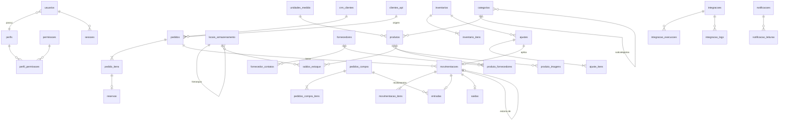

# Modelo de dados

Banco relacional PostgreSQL 17. O schema está em `apps/api/prisma/schema.prisma` e as migrations em
`apps/api/prisma/migrations`. Regras que o Prisma não expressa (CHECKs, triggers, índices parciais
e views) estão na migration `regras_integridade`.

## Diagrama (principais entidades)

## Tabelas por área

| Área             | Tabelas                                                                                                                                               |
| ---------------- | ----------------------------------------------------------------------------------------------------------------------------------------------------- |
| Acesso           | `usuarios`, `perfis`, `permissoes`, `perfil_permissoes`, `sessoes`, `logs_auditoria`                                                                  |
| Cadastros        | `categorias`, `unidades_medida`, `locais_armazenamento`, `produtos`, `produto_imagens`, `fornecedores`, `fornecedor_contatos`, `produto_fornecedores` |
| Estoque          | `saldos_estoque`, `movimentacoes`, `movimentacao_itens`, `entradas`, `saidas`                                                                         |
| Compras e vendas | `pedidos_compra`, `pedidos_compra_itens`, `pedidos`, `pedido_itens`, `reservas`, `crm_clientes`                                                       |
| Inventário       | `inventarios`, `inventario_itens`, `ajustes`, `ajuste_itens`                                                                                          |
| Integração       | `integracoes`, `integracao_execucoes`, `integracao_logs`, `integracao_eventos_recebidos`, `clientes_api`, `chaves_idempotencia`                       |
| Sistema          | `tarefas` (fila/outbox), `notificacoes`, `notificacao_leituras`, `configuracoes`                                                                      |

## Livro-razão de movimentações

- `movimentacoes` é o cabeçalho, com tipo, motivo, origem, data e hora, responsável (usuário
  **ou** cliente de API) e valor.
- `movimentacao_itens` traz produto, quantidade, custo e locais. A direção é dada pelos locais:
  - só destino = entrada;
  - só origem = saída;
  - ambos = transferência.
- `entradas` e `saidas` (1:1) guardam os dados específicos: fornecedor, nota fiscal, cliente do CRM
  e destino.
- **Imutabilidade.** Os triggers `fn_impedir_alteracao` rejeitam `UPDATE` e `DELETE`. Estornos são
  novas movimentações, com `estorno_de_id` único: um estorno por movimentação.
- **Saldo materializado.** `saldos_estoque (produto_id, local_id)` guarda `quantidade` e `reservado`,
  com os CHECKs `quantidade >= 0`, `reservado >= 0` e `reservado <= quantidade`.
- **Conciliação.** `vw_saldo_ledger` soma o ledger; `vw_conciliacao_saldos` lista divergências
  (deve estar sempre vazia). Pode ser consultada em `GET /api/v1/estoque/conciliacao`.

## Principais restrições de integridade

| Restrição                                  | Regra                                                                   |
| ------------------------------------------ | ----------------------------------------------------------------------- |
| `ck_saldo_*`                               | Saldo nunca negativo e reserva limitada ao saldo                        |
| `ck_mov_responsavel`                       | Toda movimentação tem um responsável                                    |
| `ck_mov_estorno_coerente`                  | Tipo `ESTORNO` se, e somente se, houver `estorno_de_id`                 |
| `ck_ajuste_segregacao`                     | Quem aprova o ajuste é diferente de quem o solicitou                    |
| `ck_compra_item_recebida`                  | Quantidade recebida entre 0 e a quantidade pedida                       |
| `ck_fornecedor_documento`                  | CPF com 11 dígitos (PF) ou CNPJ com 14 (PJ)                             |
| `uq_notificacoes_dedup_aberta`             | Um único alerta aberto por chave (sem repetição)                        |
| `uq_tarefas_chave_ativa`                   | Uma única tarefa pendente por chave (ex.: uma sincronização por vez)    |
| `UNIQUE (origem, id_externo)` em `pedidos` | O CRM não duplica pedidos                                               |
| `trg_pedidos_transicao`                    | Pedidos confirmados ou cancelados não mudam de status                   |
| `trg_logs_auditoria_imutavel`              | A auditoria não pode ser alterada; exclusão só pelo expurgo de retenção |

## Tipos e precisão

- Identificadores: UUID v7 (ordenáveis no tempo). Números sequenciais legíveis (`numero`) para
  movimentações, pedidos, inventários e ajustes.
- Quantidades: `numeric(18,4)`, limitadas pelas casas decimais da unidade de medida.
- Custos unitários: `numeric(18,4)`. Valores totais: `numeric(18,2)`.
- Datas: `timestamptz` (UTC no banco; exibidas no fuso America/Sao_Paulo).

## Custo médio ponderado

A cada entrada valorizada (compra ou recebimento), o novo custo médio é
`(saldo anterior × custo médio + quantidade × custo da entrada) / (saldo anterior + quantidade)`.
O estorno de uma entrada reverte o cálculo. O valor do estoque é saldo × custo médio.

## Migrations

- Desenvolvimento: `npm run db:migrate` cria e aplica migrations geradas a partir do schema.
- Homologação e produção: `npm run db:deploy`, executado pela tarefa ECS de migração no pipeline.
- Regras SQL manuais devem ir em migrations próprias, criadas com `prisma migrate dev --create-only`.
- Migrations devem ser **aditivas e retrocompatíveis**, porque a versão anterior da API continua no
  ar durante o deploy.
